# SecondHandGoodsTransPlus
社区二手交易平台 亮点：WebSocket实时沟通、社区交流与可视化、共享时间安排、 以物换物、邀请好友奖励、信用积分记录、二手交易流程； 角色：用户（卖家、买家）、管理员

所有源码均本人开发，项目是前后端分离的，所有的项目都具备了完整的业务逻辑，不仅仅局限于基础的增删改查（CRUD）操作，系统亮点众多。

本文注重于计算机毕业设计选题指导，列出题目均有源码， 大家可以去【公众号】(毕业终点站)获取或者加我【qq】(2112698948)提意见(别忘记Star哟)。备注：git

声明：仅用于学习使用，请勿用于任何商业行为！

1.系统非商用，非开源，非无偿。

2.由本人开发，如需源码，请联系以下方式，qq:2112698948。

# 社区二手交易平台

**Spring Boot 3 + Vue 2 前后端分离 · 普通用户 / 管理员 两角色协作**

WebSocket 实时沟通 · 社区可视化 · 共享时间安排 · 以物换物 · 邀请奖励 · 信用积分

---

## 一、系统亮点

- 💬 **WebSocket 实时沟通**：商品详情可联系卖家，买卖双方通过在线聊天沟通物品情况、共享时间和交付安排。
- 🌐 **社区交流与可视化**：话题发布、收藏、评论回复和点赞形成社区互动，后台用 ECharts 展示最近一周各话题浏览人次，帮助了解内容关注度。
- 🛒 **二手交易流程**：从闲置发布、商品审核、收藏咨询到下单、模拟支付、发货、收货和评价，串联买卖双方的交易操作，支持配送与自提。
- 📅 **共享时间安排**：商品上标注可共享日期、时段和截止时间，用户可按日期查找物品，并在个人中心查看自己的共享安排，方便提前沟通使用时间。
- 🔄 **以物换物**：用户在商品详情发起交换，附带物品图片、新旧程度和交换原因；卖家可同意或拒绝并留下回复，双方都能查看请求状态。
- 🎁 **邀请好友奖励**：注册时填写邀请码建立邀请关系，邀请人每日首次有效邀请可获得 10 分信用积分奖励，个人中心展示邀请码和邀请人数。
- 🌟 **信用积分记录**：新用户默认 100 分，买家完成评价后卖家加 10 分，买卖双方取消已支付订单扣 20 分；记录变动前后分值、原因和时间，便于查看信用变化。

---

## 二、技术选型

| 分类 | 技术 |
| --- | --- |
| 系统架构 | B/S、MVC、前后端分离、用户网页端 + 管理后台、管理员与普通用户角色区分 |
| 系统环境 | Windows |
| 开发环境 | IDEA、JDK 17、Maven、MySQL、Node.js |
| 后端技术 | Java、Spring Boot 3.3.1、Spring MVC、MyBatis-Plus、MySQL、JWT、WebSocket |
| 前端技术 | Vue 2.6.14、Vue CLI、Element UI、Vue Router、Vuex、Axios、ECharts、Sass、富文本编辑器 |

---

## 三、系统角色与功能

| 角色 | 主要功能 |
| --- | --- |
| 普通用户 | 注册登录与资料维护、分类筛选与商品详情收藏、闲置发布与上下架、共享时间设置与按日期筛选、物品交换发起与处理、配送 / 自提下单与模拟支付、发货收货评价与取消、购买 / 出售订单与收货地址、在线沟通、话题发布收藏评论点赞、邀请码与信用积分 |
| 管理员 | 用户信息与角色管理、商品分类与资料维护审核上下架、订单与收发货信息查询、话题分类与内容管理、轮播图维护、最近一周话题浏览人次可视化分析、个人资料与密码管理 |

---

## 四、系统实现（核心截图）

### 4.1 普通用户端

<table>
  <tr>
    <td width="50%" align="center">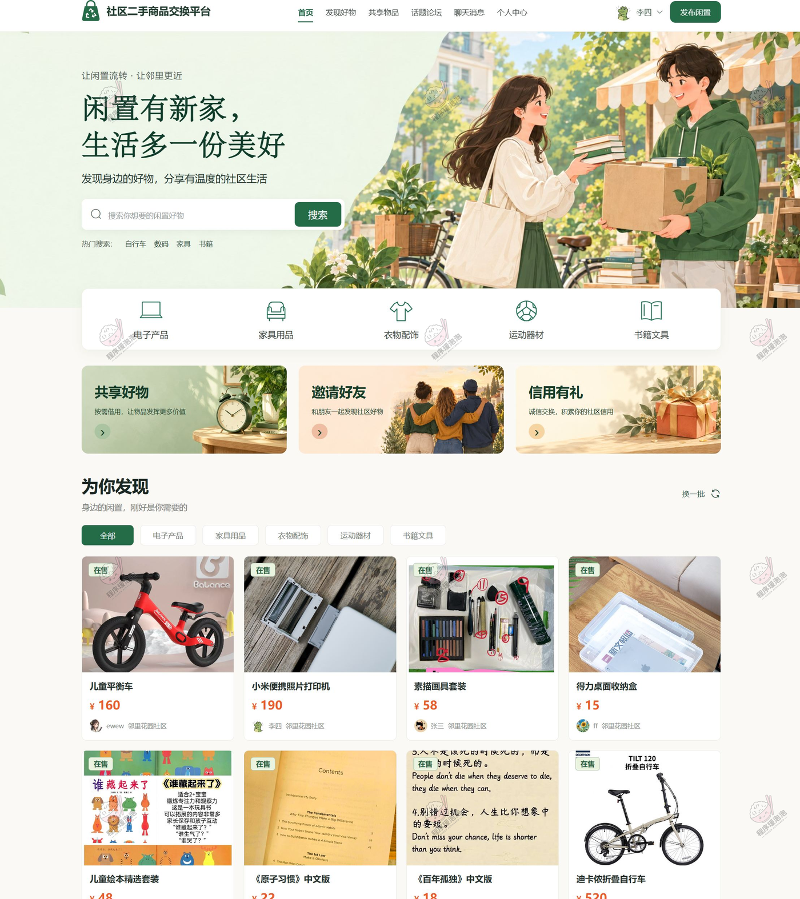 <b>首页</b></td>
    <td width="50%" align="center">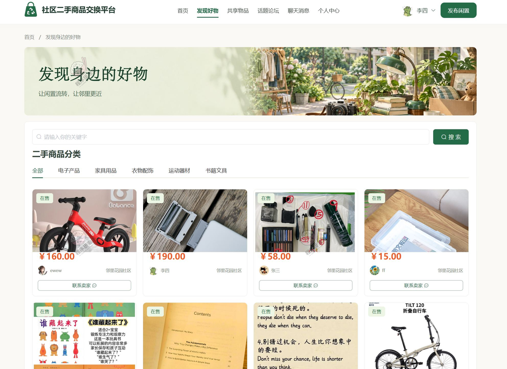 <b>发现好物</b></td>
  </tr>
  <tr>
    <td width="50%" align="center">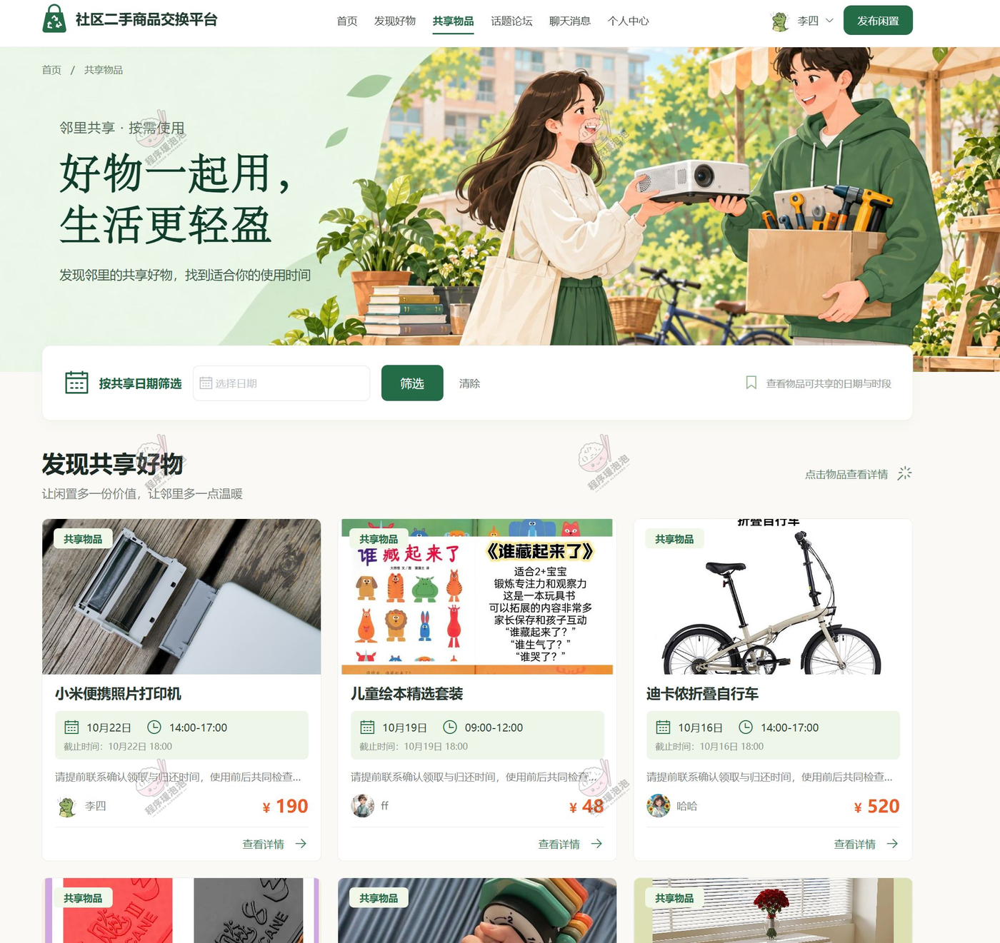 <b>共享物品</b></td>
    <td width="50%" align="center">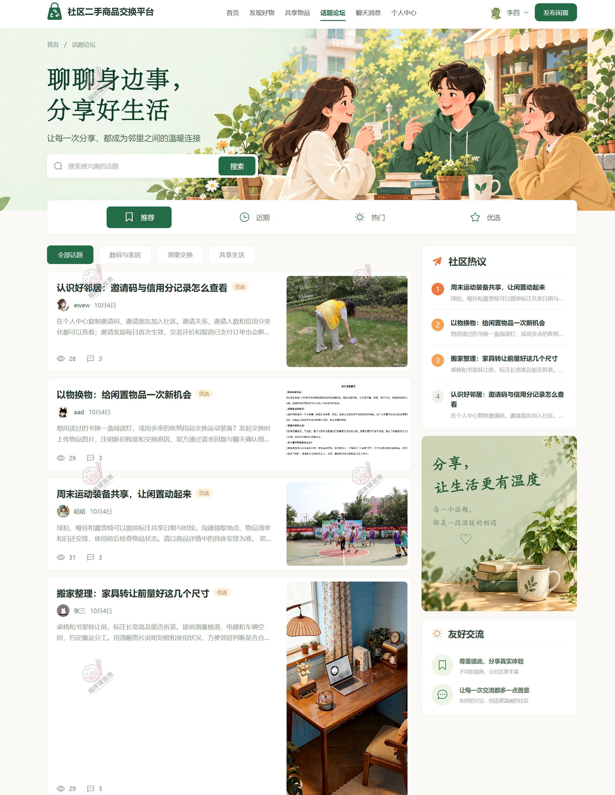 <b>话题论坛</b></td>
  </tr>
</table>

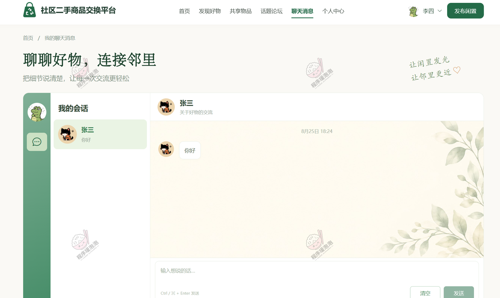

<b>在线聊天</b>

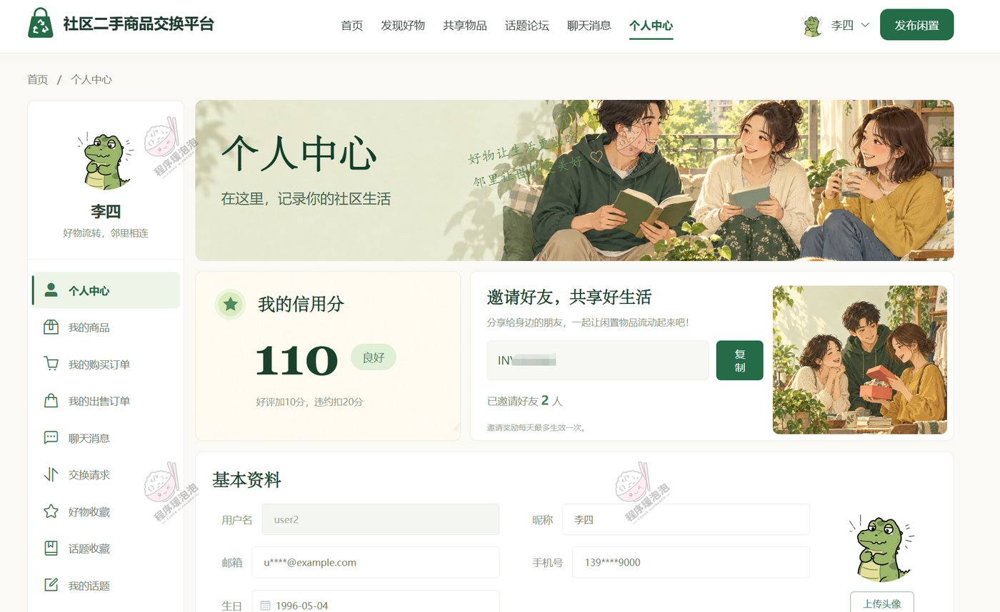

<b>个人中心（邀请码 · 信用积分）</b>

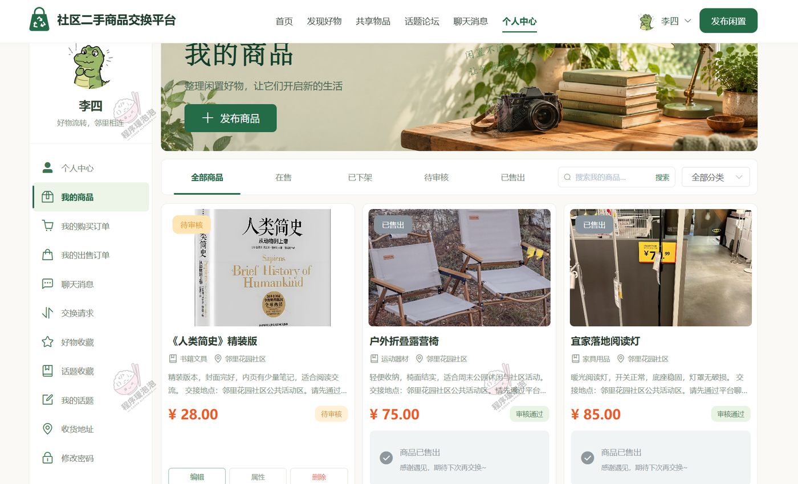

<b>我的商品</b>

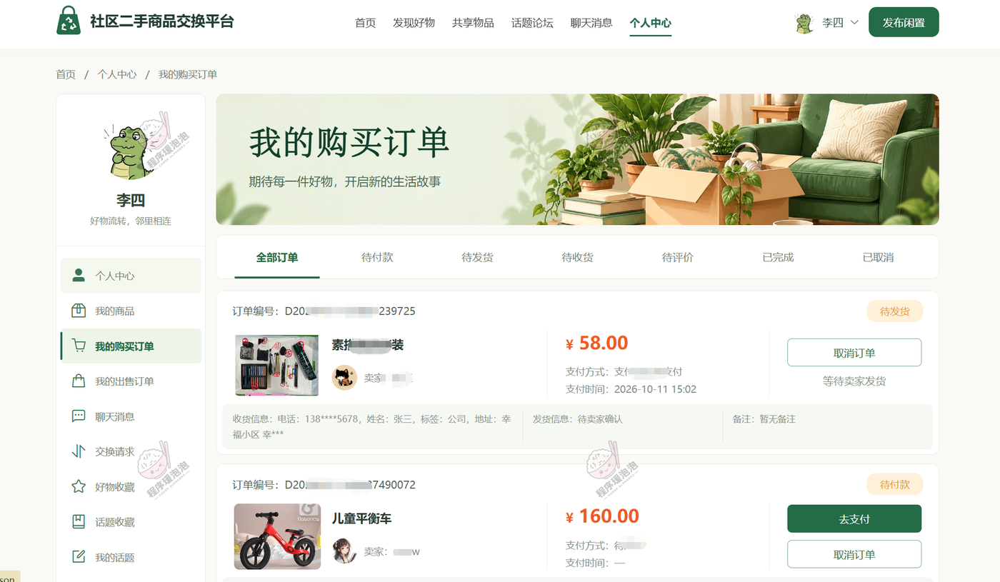

<b>我的购买订单</b>

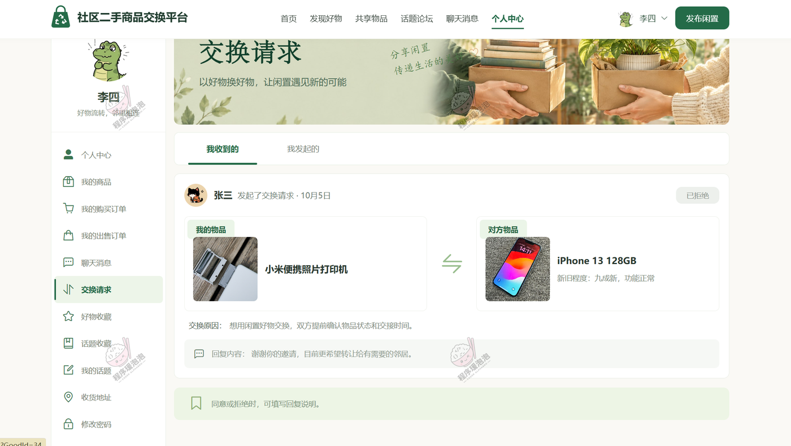

<b>交换请求</b>

用户端其余页面：商品详情、话题详情。

### 4.2 管理员端

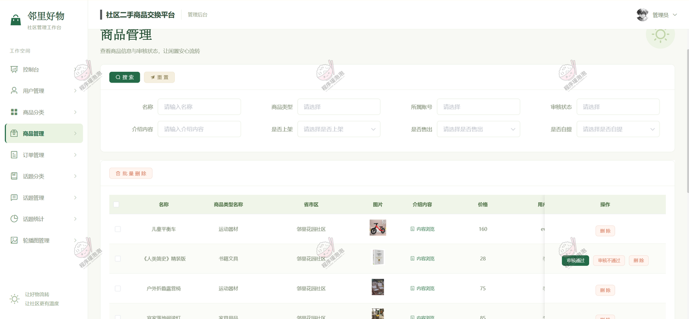

<b>商品管理（审核上下架）</b>

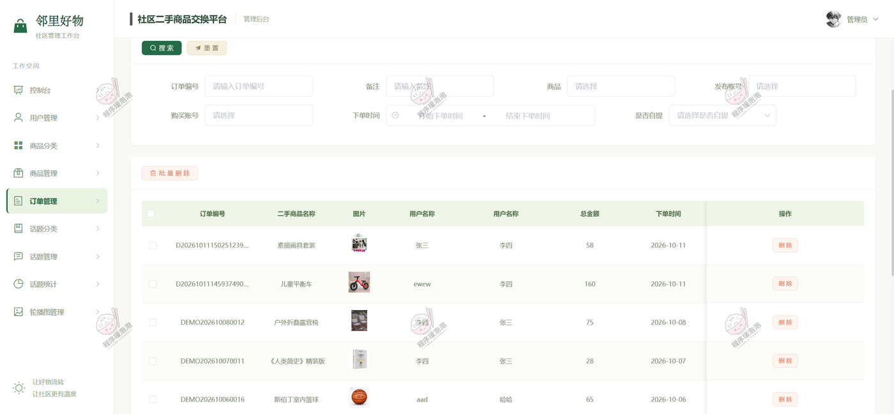

<b>订单管理</b>

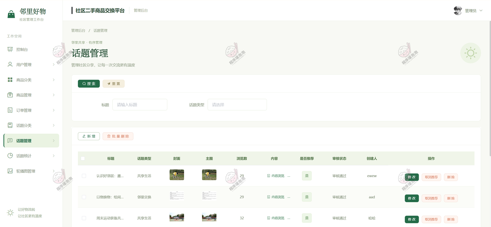

<b>话题管理</b>

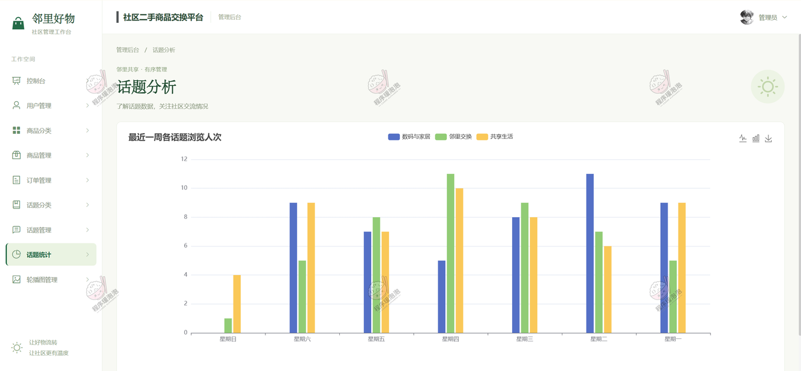

<b>话题统计（ECharts 可视化）</b>

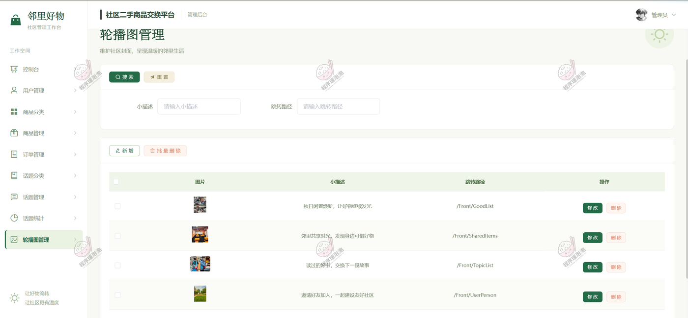

<b>轮播图管理</b>

管理员端其余页面：用户管理、个人中心。

---

## 五、关于本项目

本文档展示的是系统核心功能截图，完整源码、数据库脚本和部署说明不在仓库内展示。截图均存放于本地 `images/` 目录，不依赖外部图床。

如需了解完整功能、获取源码或定制开发，欢迎联系。

**文档展示 15 张截图，需要了解更多，请联系我。**
